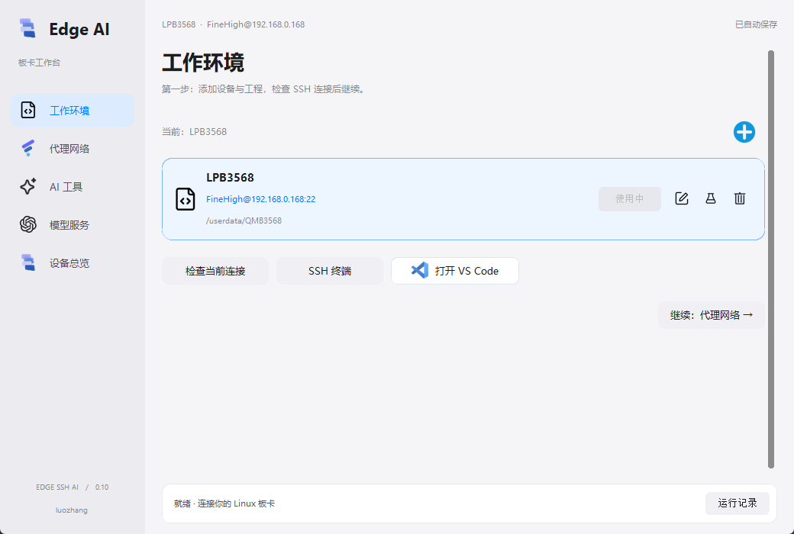
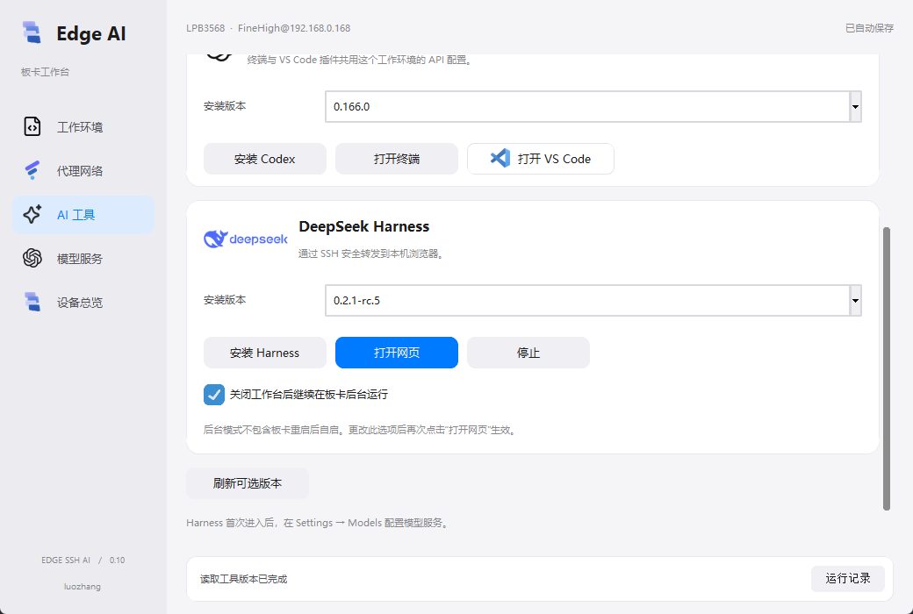
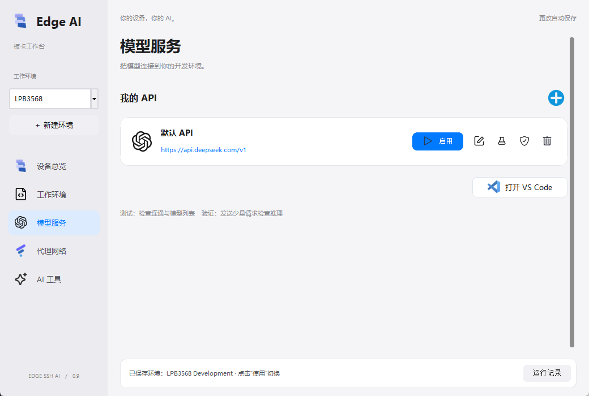
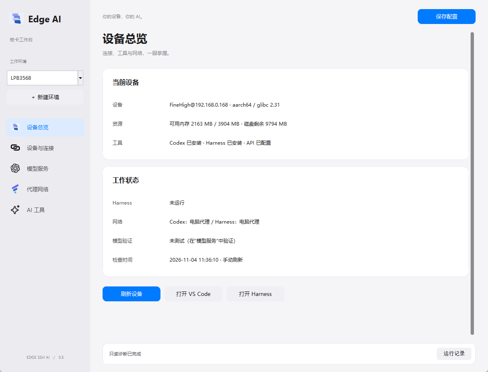

<div align="center">

[简体中文](README.md) | **English**


# Edge Switch

**A remote AI development workbench for Linux boards**

Manage SSH environments, proxies, and model services from Windows. Deploy Codex and DeepSeek Harness on your Linux devices and open your remote workspace from one place.

[](https://github.com/luozhang52/Edge-switch/releases)
[](#requirements)
[](#tauri-development-and-builds)
[](#requirements)
[](https://github.com/luozhang52/Edge-switch/releases)
[](https://github.com/luozhang52/Edge-switch/stargazers)
[](LICENSE)

[Download](#download-and-install) · [Quick start](#quick-start) · [FAQ](#faq) · [Star History](#star-history) · [Support](#support-the-project)

</div>

> The main branch is migrating to Tauri 2, Rust, React and TypeScript (2.0.0-alpha.1). The stable release remains [v1.1.3](https://github.com/luozhang52/Edge-switch/releases/tag/v1.1.3). The new desktop has not completed real-board acceptance and has no published Release. See [migration and development notes (Chinese)](docs/tauri-migration.md). Historical screenshots and Python instructions below refer to the legacy desktop.

Configure provider APIs separately for Codex, Claude Code, DeepSeek Harness, Gemini CLI, and OpenCode. See [model services](docs/model-services.md) (Chinese).

## Overview

Edge Switch brings device connections, tool installation, network settings, and model authentication into one desktop application. Create work environments for different devices or projects, switch between an official ChatGPT account and custom APIs, and launch VS Code or the Harness web interface.

The current source version is **2.0.0-alpha.1**. The window, tray, and installer use the name **Edge Switch**. The legacy `EdgeSSHAI` configuration directory is retained for upgrade compatibility. The desktop app runs on Windows; AI tools run on the Linux device over SSH. The application UI is currently in Chinese; these documentation pages are available in both languages.

## Features

| Feature | What it does |
| --- | --- |
| Work environments | Manage devices, SSH identities, and project directories with cards; restore the last selection |
| First-time SSH setup | Generate a key on each PC and authorize its public key using an interactive terminal; no SSH password storage |
| Tool deployment | Install a separate Node.js runtime and select published Codex / Harness versions from a background-loaded list |
| Model services | Add, edit, and switch APIs alongside the built-in OpenAI Official card |
| Official accounts | Device-code login or import your own Codex `auth.json`, stored separately from API credentials |
| Tests and verification | Separate connectivity checks from inference; request confirmation before consuming model quota |
| Network routing | Select direct access or a PC proxy for each tool; SSH tunnels reconnect after interruptions |
| VS Code integration | Check Remote SSH and the remote Codex extension; configure an environment-specific launcher |
| Harness web access | Access over SSH forwarding, reconnect to an existing service, and optionally keep it running on the board |
| Tray and installer | Close to the system tray; install the Windows build without installing Python |

### Screenshots

These screenshots show earlier versions. Current layouts and controls may differ.

<table>
  <tr>
    <td align="center"><br />Work environments</td>
    <td align="center"><br />AI tools</td>
  </tr>
  <tr>
    <td align="center"><br />Model services</td>
    <td align="center"><br />Device overview</td>
  </tr>
</table>

## Requirements

| Component | Requirement |
| --- | --- |
| Local PC | Windows x64 with the OpenSSH client installed |
| Remote editor | VS Code with the `code` command available |
| Linux device | ARM64 / x86_64, glibc ≥ 2.28, Python ≥ 3.8, and a running SSH server |
| Storage and permissions | A writable home directory and enough space for the selected tools; runtime installation checks free space |
| Network | SSH connectivity between PC and device; separate working routes for downloads, the extension marketplace, and model services |

Hardware validated so far: **LPB3568 / ARM64 / glibc 2.31**. ARMv7, RISC-V, musl / Alpine, and Android are not currently supported. Each distribution must also satisfy VS Code Server and upstream tool dependencies.

## Download and install

Check [Releases](https://github.com/luozhang52/Edge-switch/releases) for published builds. If release assets are unavailable, build from source using the instructions below.

| Distribution | File | Usage |
| --- | --- | --- |
| Installer | `EdgeSwitch-Setup-1.1.3.exe` | Per-user installation with shortcuts and uninstaller |
| Portable | `EdgeSwitch-1.1.3-Windows-x64.zip` | Extract and run the EXE; includes license and bilingual documentation |
| Corresponding source | `EdgeSwitch-1.1.3-source.zip` | Source snapshot for this build, including resources and build scripts |

`SHA256SUMS.txt` contains release file checksums. Versions use `MAJOR.MINOR.PATCH`; the release tag is `v1.1.3`. A version number does not imply every Linux distribution or upstream tool version has been validated.

Before upgrading, select **退出程序 (Exit)** from the sidebar or tray menu. Closing the window only hides it to the tray. Installers do not include the developer's device settings, API keys, SSH private keys, or account credentials. Each PC needs its own SSH authorization and model authentication.

## Quick start

### 1. Create a work environment

Open **工作环境 (Work environments)** and add a device address, Linux username, SSH port, and project directory. Example: `192.168.1.100` and `/home/developer/project`.

Click **配置 SSH 登录 (Set up SSH login)**. Verify the host fingerprint and enter the Linux password in the terminal. Run the connection test and confirm that device information is readable before continuing. If you already have an authorized key, select its private key file in the editor.

### 2. Choose network routes

In **代理网络 (Proxy network)**, select direct access or the PC proxy separately for Codex and Harness. Skip proxy setup if the required services are directly accessible.

For PC proxy access, start FlClash or another compatible proxy and enter its actual HTTP / mixed port. Runtime downloads and version queries have a separate network option; tool installation follows each tool's settings.

```text
AI tool on Linux → reverse SSH tunnel → PC HTTP / mixed proxy → model service
```

Browser authentication uses the PC browser's own network route. The device proxy switch does not configure your browser.

### 3. Install tools

Open **AI 工具 (AI tools)** and click **检测板卡工具 (Detect board tools)**. If tools already exist under this Linux account, click **使用已有工具 (Use existing tools)** to validate and reuse binaries without copying credentials or tasks. Otherwise install the managed Node.js runtime and select versions for Codex or Harness. Versions load in the background. Open **运行记录 (Activity log)** for results. The managed runtime does not replace the device's system Node.js.

### 4. Activate a model service

**Official account:** Enable **OpenAI Official** in **模型服务 (Model services)**. If not signed in, choose **账号登录 (Account login)** in the editor and follow the terminal instructions in your browser. Alternatively, import your own authenticated Codex `auth.json`. No API key is required.

**Custom API:** Click the plus button and enter the service name, HTTPS base URL, exact model ID, protocol, and API key. Codex requires **Responses**. Chat Completions services can be saved and tested. Hover over a saved card and click **启用 (Enable)**; successful activation changes it to **使用中 (In use)**.

| Action | Custom API | OpenAI Official |
| --- | --- | --- |
| Edit | URL, model, protocol, and key | Name, note, credential import, and account login |
| Test | Connectivity and model list | Official web connectivity and CLI credential recognition |
| Verify | Minimal inference request | Minimal inference through official Codex |
| Delete | Remove the local record and saved key | Disabled for the built-in service |

A successful connectivity test does not guarantee inference. Verification asks for confirmation before consuming API balance or account quota; only a complete model response passes. Official account access and quota depend on the account plan and service availability.

### 5. Start remote development

- **VS Code:** Click **打开 VS Code (Open VS Code)** and use the environment window it opens. If an existing window retains old settings, save your work and run `Developer: Reload Window`. Reopen existing Codex terminals as well.
- **Codex terminal:** Choose **打开终端 (Open terminal)** under Codex in AI tools.
- **Harness:** Click **打开网页 (Open web page)** and configure models under **Settings → Models**. Harness manages its own model settings; API keys are not automatically copied from this workbench.

Closing the Harness browser tab does not stop its background service. Opening it again attempts to reconnect. Click **停止 (Stop)** to end the service.

## Configuration and data

| Location | Contents |
| --- | --- |
| `%LOCALAPPDATA%\EdgeSSHAI` | Local environments, encrypted credentials, SSH keys, caches, and private VS Code settings |
| `%LOCALAPPDATA%\Programs\Edge Switch` | Default directory for fresh installs; upgrades retain the existing directory |
| `~/.local/share/edge-ssh-ai/<environment-id>/` | Device runtime, tools, model settings, and background service state |

Saved API keys use Windows DPAPI and are bound to the Windows user. Imported official credentials are also encrypted locally. They travel to the device over SSH; authentication files have `0600` permissions. Official and API modes use separate directories and retain their credentials when switching. Repeated imports of the same snapshot do not overwrite tokens already rotated by Codex.

Uninstalling preserves local user settings and device data. Verify the environment ID before manually removing an environment's directory.

### Sharing a Linux account

Each PC creates a distinct environment identity for its settings, launchers, and connections. The workbench does not modify shared `~/.codex`, `.bashrc`, or `.profile`, automatically restart shared VS Code Server, or stop other users' tasks by process name.

This provides configuration management, **not security isolation**. Users sharing one Linux account can access each other's files and share CPU, memory, and disk. Since v1.1.0, each environment uses a separate VS Code Server directory. Do not copy an entire local profile to another PC and run both simultaneously: they may reuse the same environment identity.

## FAQ

<details>
<summary><strong>Can system VS Code updates stop triggering repeated server downloads?</strong></summary>

Since v1.1.0, the workbench copies the installed Windows editor into its own directory on first use and keeps that version. Dedicated windows disable automatic editor and extension updates; Remote SSH extensions also use a private directory. Use **AI 工具 → 编辑器版本 (Editor version)** to explicitly select the current system version or another installed `Code.exe`. Save and close workbench remote windows before switching. A new version may require matching server files and extensions. The copy uses extra local disk space; schedule manual upgrades for fixes and compatibility.

If a runnable server with the exact same commit already exists on the board, its executable files are copied into the environment without downloading. Credentials, extensions and locks are excluded. First deployment still needs matching files when neither side has them. Codex terminal and Harness do not require VS Code Server.

</details>

<details>
<summary><strong>Does every reboot or remote connection download VS Code Server again?</strong></summary>

No. A server matching the PC's VS Code commit starts directly and survives reboots. Since v1.1.0, verified archives are also stored in `%LOCALAPPDATA%\EdgeSSHAI\downloads\vscode` for installation into new environments. Completed download chunks are retained after failure for retry. A VS Code update, first installation into an environment, or deleted files may require preparation. Server caching does not replace network access to model APIs.

</details>

<details>
<summary><strong>VS Code reports Permission denied (publickey,password)</strong></summary>

This is SSH authentication failure, unrelated to the API key. Run first-time SSH setup on that PC, or select a private key whose public key is already authorized on the device.

</details>

<details>
<summary><strong>The authorization page reports unsupported_country_region_territory</strong></summary>

Check the PC browser's network route and official regional availability. Browser and device routes are configured separately. Enabling only the device proxy does not change browser routing; importing credentials does not guarantee a change to service-side restrictions.

</details>

<details>
<summary><strong>The model list works but inference fails</strong></summary>

Check the exact model ID, provider group permissions, balance, and upstream channel availability. A display name may differ from the API model ID. Use Verify for an actual inference test.

</details>

<details>
<summary><strong>VS Code still appears signed out after switching</strong></summary>

Reopen VS Code from the workbench and run `Developer: Reload Window` in existing windows. If opening stalls, use **连接诊断 (Connection diagnostics)** on the model services page and check the VS Code login terminal. Other launch paths do not automatically use these environment-specific settings. Reopen after extension upgrades to synchronize the launcher.

</details>

<details>
<summary><strong>Will Harness keep running after I exit?</strong></summary>

With background mode enabled, the process can keep running on Linux. Exiting the workbench closes its SSH connections. If Harness uses the PC proxy, model requests need the workbench to reconnect. Direct access does not depend on that proxy tunnel. Background mode does not include automatic startup after a device reboot.

</details>

<details>
<summary><strong>SSH or VS Code disconnects intermittently</strong></summary>

Check LAN connectivity, SSH service health, and device CPU / memory load. Choose the actual project directory instead of `/` to avoid broad file scans. Inspect logs and device status before removing VS Code Server files.

</details>

## Tauri development and builds

Install Node.js 24, Rust stable, MSVC Build Tools and WebView2. Run `npm ci` and `npm run tauri dev`. Use `npm run desktop:build` for the alpha installer and portable ZIP in ignored `dist/tauri/`. See the [migration notes](docs/tauri-migration.md) for checks, isolated desktop smoke tests and rollback.

## Legacy Python development and builds

Source execution requires **Windows Python 3.10+ with tkinter**:

```powershell
git clone https://github.com/luozhang52/Edge-switch.git
cd Edge-switch
python -m venv .venv
.\.venv\Scripts\python.exe -m pip install -r requirements.txt
.\.venv\Scripts\python.exe start_workbench.py
```

Install PyInstaller in the same Python environment. Installer builds also require Inno Setup 6, installed system-wide or in `build/toolchain/inno`.

```powershell
.\.venv\Scripts\Activate.ps1
python -m pip install pyinstaller
.\Build-Workbench.cmd
.\Build-Installer.cmd
```

| Module | Responsibility |
| --- | --- |
| `workbench/app.py` | UI actions and background tasks |
| `workbench/layout.py`, `workbench/ui.py` | Layout and reusable controls |
| `workbench/core.py` | Local configuration, DPAPI, SSH, and tunnels |
| `workbench/api_ui.py`, `workbench/official_ui.py` | API cards and official account settings |
| `workbench/remote_agent.py` | Operations executed on the Linux device over SSH |
| `workbench/harness_service.py` | Harness background service management |

Basic checks:

```powershell
python start_workbench.py --self-check
python -m unittest test_auth test_reopen test_workbench test_repair test_lifecycle
python -m unittest test_api_services
python -m unittest test_official_card
python -m unittest test_official_import.OfficialImportTests
```

`verify_board_05.py` and `verify_board_06.py` are optional device integration checks. They require a configured device and managed tools, create temporary environments, clean up afterward, and do not automatically send inference requests. Passing regression checks does not validate every account, provider, or board.

## Releases and feedback

- [Releases and downloads](https://github.com/luozhang52/Edge-switch/releases)
- [Issues and feature requests](https://github.com/luozhang52/Edge-switch/issues)
- [Historical documentation, Chinese](docs/历史说明.md)
- [Validation notes, Chinese](docs/第一版验证记录.md)

Include the app version, OS, device architecture, reproduction steps, and redacted logs when reporting issues. Never upload API keys, SSH private keys, or account tokens from `auth.json`.

## Acknowledgments

- [OpenAI Codex](https://github.com/openai/codex): AI coding assistance.
- [DeepSeek Harness](https://github.com/deepseek-ai/deepseek-harness): terminal and web AI development workflows.
- [CC Switch](https://github.com/farion1231/cc-switch): a reference for provider cards and official account configuration.
- [CustomTkinter](https://github.com/TomSchimansky/CustomTkinter), [PyInstaller](https://github.com/pyinstaller/pyinstaller), and [Inno Setup](https://jrsoftware.org/isinfo.php): desktop UI and Windows packaging.

## License

Copyright © 2026 luozhang. Original Edge Switch code is licensed under **GNU Affero General Public License v3.0 (AGPL-3.0-only)**. See [LICENSE](LICENSE) for the full terms.

- Use, study, modification, and commercial use are allowed. AGPL does not prohibit commercial use.
- When conveying covered software or modified versions, retain copyright and license notices and provide Corresponding Source as required. Modified covered versions must be licensed under AGPL-3.0 and identify modifications.
- If you modify the program and let users interact with that version over a network, Section 13 requires prominently offering those users access to its Corresponding Source at no charge.
- The software is provided without warranty, subject to the full license terms.

Third-party dependencies, upstream tools, and assets owned by others retain their respective licenses and terms. This summary does not replace the full LICENSE.

## Star History

[](https://www.star-history.com/#luozhang52/Edge-switch&Date)

## Support the project

If Edge Switch saves you deployment or troubleshooting time, consider starring the repository, sharing feedback, or making a voluntary donation to support maintenance.

<div align="center">
<table>
  <tr>
    <th align="center">WeChat Pay</th>
    <th align="center">Alipay</th>
  </tr>
  <tr>
    <td align="center"></td>
    <td align="center"></td>
  </tr>
</table>

Maintained by **luozhang**
</div>
