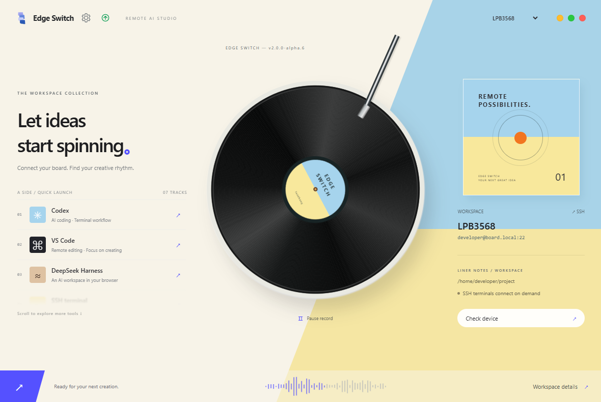
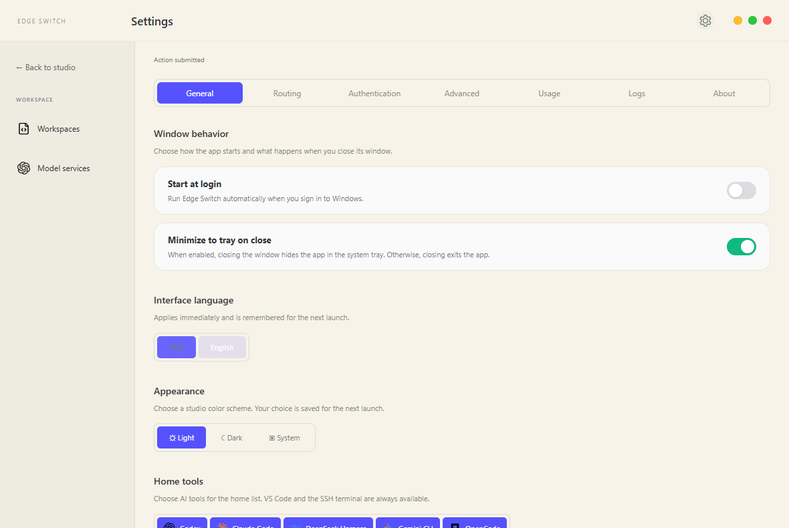
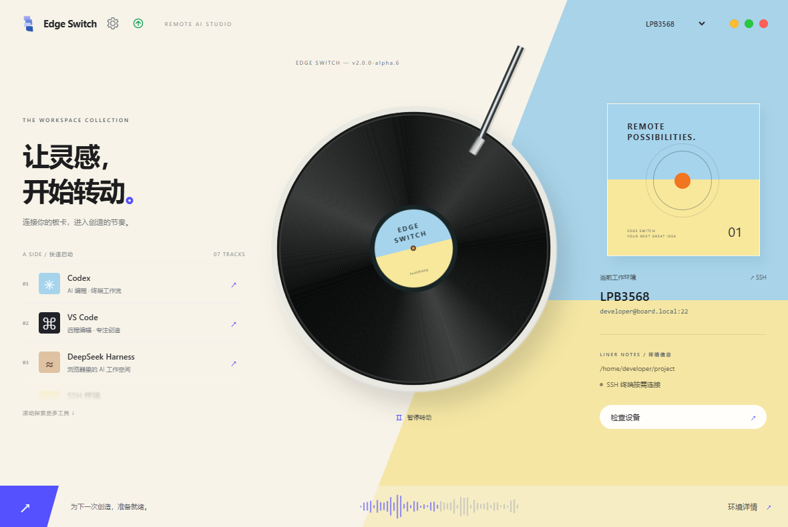
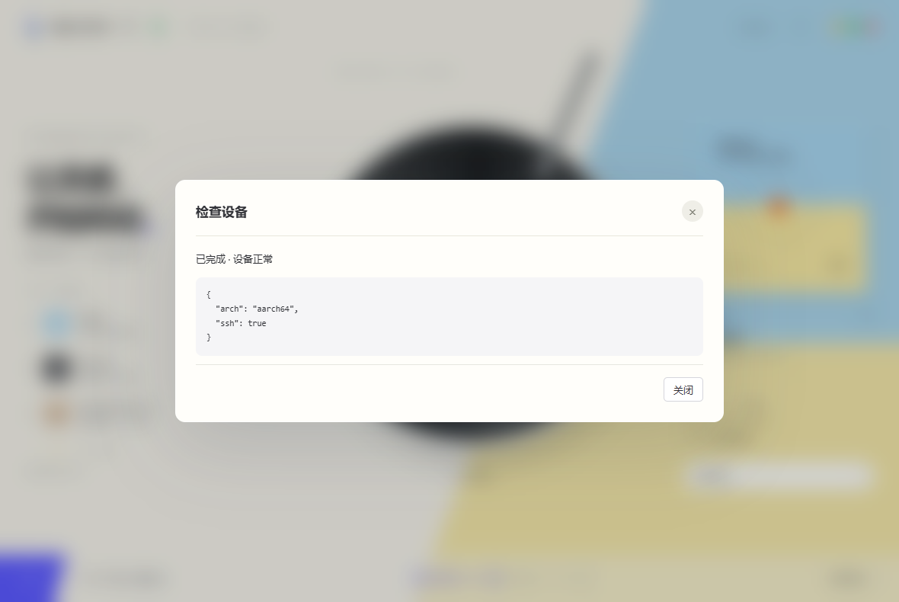

<div align="center">
  

# Edge Switch

Recent workspace updates: drag home shortcuts to persist their order; switch DeepSeek Harness back from API providers to its account channel; distinguish an explicitly selected official entry from a verified login. The sidebar includes a session center with search, tool filters, conversation reading, Markdown export, and resume-command copying. Local Windows reads complete native records (up to 128 MiB per file after decompression), resolves Codex project metadata and titles from its index/read-only state database, and reads compressed Harness logs without external tools. Harness uses the latest log generation per session and tolerates incomplete appended compression frames. Native Codex, Claude Code, and Harness token usage is read from logs; historical providers come from those logs, and costs without recorded amounts are estimated using workspace prices when available. Model services detects the current native Codex provider, model, and endpoint without importing credentials. SSH workspaces scan only their managed environment, with up to 200 files and 4 KiB previews; remote details read at most 1 MiB and indicate truncation. OpenCode SQLite sessions are not yet supported. Exports contain only the loaded content.

Configure AI tools, proxy networking, and model APIs on Linux boards over SSH.

[中文](README.md) · [English](README.en.md) · [Download v2.0.0-alpha.6](https://github.com/luozhang1024/Edge-switch/releases/tag/v2.0.0-alpha.6)

[](https://github.com/luozhang1024/Edge-switch/releases)
[](LICENSE)

</div>

## Overview

Edge Switch is a Windows desktop built with Tauri 2, Rust, React, and TypeScript. AI CLI tools run on your SSH-connected Linux board. The desktop manages installation, launch, proxy forwarding, official account login, and model API providers.

**2.0.0-alpha.7 is a prerelease.** Local automated and UI checks have passed, but this version has not completed real-board or broad Windows compatibility acceptance. See the [migration notes](docs/tauri-migration.md) and [legacy documentation](docs/历史说明.md).

## What's new

The local development version is `2.0.0-alpha.7`. Packaging does not publish a GitHub Release. The download links below still point to the published alpha.6 release. See [alpha.7 changes and packaging conventions](docs/releases/v2.0.0-alpha.7.md).

- Configure SSH and proxies when creating or editing a workspace; use the sidebar's Tool installation page for deployment.
- Each CLI starts with its official entry; Harness offers a DeepSeek API entry to configure. Hover to reveal actions; drag workspaces and providers to save your preferred order.
- Choose **Start at login**, **Minimize to tray on close**, and **中文 / English** in **Settings → General**. Language switches immediately and persists.
- Tasks open a progress and result dialog. History lives in **Settings → Logs**.
- The portable ZIP includes a signed Microsoft WebView2 bootstrapper and a diagnostic launcher. Startup errors appear in a dialog and are recorded in a log.

Startup registration applies to the current Windows user without administrator rights. Keep portable installations in a fixed directory; after moving one, toggle startup off and on to refresh the path. Closing to the tray is enabled by default. If disabled, closing or Alt+F4 exits the app; active tasks must first finish or be canceled.

The sidebar includes **Tool installation** for the selected saved workspace, with category filtering, search, installed tools first, detected versions, and supported install, upgrade and uninstall actions. AI tool visibility in Model services is saved per workspace. Windows uses npm for AI tools and winget for Node.js, Git and VS Code; externally installed AI tools require their original management method. SSH manages private AI installations, preserves shared binaries when uninstalling, and only detects system tools. Usage totals prefer recorded USD amounts and estimate other requests from the reference pricing snapshot in `cc-switch-reference/src-tauri/src/database/schema.rs`. **Set prices** overrides rates per workspace, provider and model, with separate fresh input, output, cache read and cache write prices in USD per million tokens. Totals cover all filtered requests before pagination and show pricing coverage. Missing rates stay unknown; subscription routes require explicit provider pricing. Estimates are not provider bills.

## Screenshots

**Prompt groups** in the sidebar manages lasting instructions for Codex, Claude Code, Gemini CLI, DeepSeek Harness, and OpenCode. Add, search, edit, copy, duplicate, enable, disable, and delete entries; each tool has one active prompt. The page displays the actual target file and size. Existing file contents are imported automatically, external edits are preserved, and replacements create `.edge-switch-*.bak` backups. Disabling clears the target while keeping the library entry. Native Windows and SSH workspaces use separate libraries; SSH targets stay within the selected managed workspace and account/API channel.

| Studio | General settings |
| --- | --- |
|  |  |
|  |  |

## Download and install

Get builds from the [v2.0.0-alpha.6 Release](https://github.com/luozhang1024/Edge-switch/releases/tag/v2.0.0-alpha.6).

| File | Purpose |
| --- | --- |
| `Edge Switch_2.0.0-alpha.6_x64-setup.exe` | Recommended. Per-user installation, WebView2 detection and download, uninstaller |
| `EdgeSwitch-2.0.0-alpha.6-Windows-x64.zip` | Extract the entire ZIP, then run `Launch-EdgeSwitch.cmd` |
| `EdgeSwitch.exe` | Standalone executable; requires WebView2 already installed |
| `EdgeSwitch-2.0.0-alpha.6-source.zip` | Corresponding source snapshot |
| `SHA256SUMS.txt` | SHA-256 checksums for release files |

Requires **Windows 10/11 x64** and **Microsoft Edge WebView2 Runtime**. Windows 7/8, 32-bit systems, and native ARM builds are not provided. The included WebView2 bootstrapper requires Internet access. For offline PCs, install Microsoft's official matching offline WebView2 runtime first.

Exit existing instances from the tray before upgrading. Packages do not include developer settings, keys, or login credentials. Each colleague must authorize SSH on their own PC and authenticate model accounts in their remote workspace.

### Nothing happens or the app exits immediately

1. Extract the **entire ZIP** into a local directory. Do not run from an archive manager's temporary directory.
2. Run `Launch-EdgeSwitch.cmd`. It reports system information, checks WebView2, offers Microsoft's bootstrapper if needed, and keeps the console open on failure.
3. Check `%LOCALAPPDATA%\EdgeSSHAI\portable-launch.log` and `startup.log`. If neither exists, record any Windows security or system error message.
4. Check the system tray for an existing instance and exit it before restarting.

SmartScreen may warn because the app is not code signed. Verify the download source and SHA-256; do not disable security software. A silent launch alone does not identify the cause.

## Quick start

1. Click the record to open **Workspaces**. Create a board and enter SSH host, user, port, private key, and project directory in **SSH and network**.
2. Select the workspace and open **Tool installation** in the sidebar. Choose a category and install a tool in one click. On Windows, install Node.js before AI tools; Node.js, Git and VS Code require winget. SSH automatically prepares private Node.js for AI tools without replacing system Node.js. Remote runtime upgrades and removal are disabled to preserve dependencies.
3. Configure proxy routes if needed. The board accesses the PC proxy through reverse SSH forwarding. Disconnect existing tunnels before changing settings.
4. Click the album cover for **Model services**. Select a CLI first, then its official account or an API provider. Shared New API configurations can serve multiple tools.
5. Authenticate Codex's OpenAI Official in **Settings → Authentication** or import `auth.json`. Claude, Gemini, and OpenCode official cards provide terminal login. Harness requires a model and API key.
6. Hover a provider and activate it using the first action. Sync API settings to the board, then return home to launch your tools.

Upstream CLIs determine account and subscription requirements. Opening a login terminal does not mean authorization succeeded. Custom Codex APIs require a Responses-compatible endpoint. Inference tests can consume credits and require confirmation.

Boards need SSH, Python 3, a writable user directory, and upstream tool dependencies. Earlier real-device checks used **LPB3568 / ARM64 / glibc 2.31**; other boards, providers, and tool versions need independent validation.

## Data and security

- Local configuration remains in `%LOCALAPPDATA%\EdgeSSHAI` for upgrade compatibility.
- Saved API keys are encrypted using the current Windows user's DPAPI. Unsaved keys stay in process memory.
- Official accounts and custom APIs use separate per-tool workspace directories on the board. The app does not replace shared `~/.codex` or modify `.bashrc`.
- Home tracks app-managed proxy and web tunnels only. External SSH terminals connect independently. Use **Check device** to verify SSH.
- Do not share private keys, API keys, `auth.json`, or local configuration. Separate Linux users are required for strong isolation from other board users.

See [model service documentation](docs/model-services.md) for details.

## Development

Windows builds require Node.js 24, Rust stable, MSVC Build Tools, and WebView2.

```powershell
npm ci
npm test
npm run test:ui
npm run build
cargo test --manifest-path src-tauri/Cargo.toml --locked --lib
npm run desktop:build
```

Artifacts go to the ignored `dist/tauri/` directory. Exit existing instances before `npm run test:desktop`, which checks the packaged app through WebView2. Browser UI tests use simulated board data, not a live board.

Pushing a `v2.*` tag triggers Windows checks and packaging. A prerelease and checksums are published only after the required checks pass. Legacy Python code and regression tests remain for migration validation; their build commands do not produce 2.x Releases.

## Feedback

Open an [issue](https://github.com/luozhang1024/Edge-switch/issues) with your app version, Windows version, CPU architecture, exact error, and redacted logs. Include startup logs for launch failures. Never upload keys or account tokens.

## Acknowledgments

- [OpenAI Codex](https://github.com/openai/codex): AI coding assistance.
- [DeepSeek Harness](https://github.com/deepseek-ai/deepseek-harness): terminal and web AI development workflows.
- [CC Switch](https://github.com/farion1231/cc-switch): a reference for provider cards and official account configuration.
- [CustomTkinter](https://github.com/TomSchimansky/CustomTkinter), [PyInstaller](https://github.com/pyinstaller/pyinstaller), and [Inno Setup](https://jrsoftware.org/isinfo.php): desktop UI and Windows packaging.

## License

Copyright © 2026 luozhang. Original Edge Switch code is licensed under **GNU Affero General Public License v3.0 (AGPL-3.0-only)**. See [LICENSE](LICENSE) for the full terms.

- Use, study, modification, and commercial use are allowed. AGPL does not prohibit commercial use.
- When conveying covered software or modified versions, retain copyright and license notices and provide Corresponding Source as required. Modified covered versions must be licensed under AGPL-3.0 and identify modifications.
- If you modify the program and let users interact with that version over a network, Section 13 requires prominently offering those users access to its Corresponding Source at no charge.
- The software is provided without warranty, subject to the full license terms.

Third-party dependencies, upstream tools, and assets owned by others retain their respective licenses and terms. This summary does not replace the full LICENSE.

## Contributions and commercial licensing

Code, documentation, tests and issue reports are welcome; see [CONTRIBUTING.md](CONTRIBUTING.md). Community contributions are provided under AGPL-3.0-only, and contributors retain copyright. **No CLA, separate signing comment or DCO Signed-off-by is required.**

A separate proprietary, paid enterprise edition is also developed. Submitting or merging a PR does not grant additional rights for proprietary commercial relicensing. Before incorporating an external contribution into the closed-source enterprise edition, the maintainer will separately seek explicit written authorization from the relevant rights holders, who may decline.

Contact maintainer `luozhang1024` through this repository for enterprise or alternative commercial licensing. Commercial use of the community edition under AGPL does not itself require buying the enterprise edition.

## Star History

[](https://www.star-history.com/#luozhang1024/Edge-switch&Date)

## Support the project

If Edge Switch saves you deployment or troubleshooting time, consider starring the repository, sharing feedback, or making a voluntary donation to support maintenance.

<div align="center">
<table>
  <tr>
    <th align="center">WeChat Pay</th>
    <th align="center">Alipay</th>
  </tr>
  <tr>
    <td align="center"></td>
    <td align="center"></td>
  </tr>
</table>

Maintained by **luozhang**
</div>
