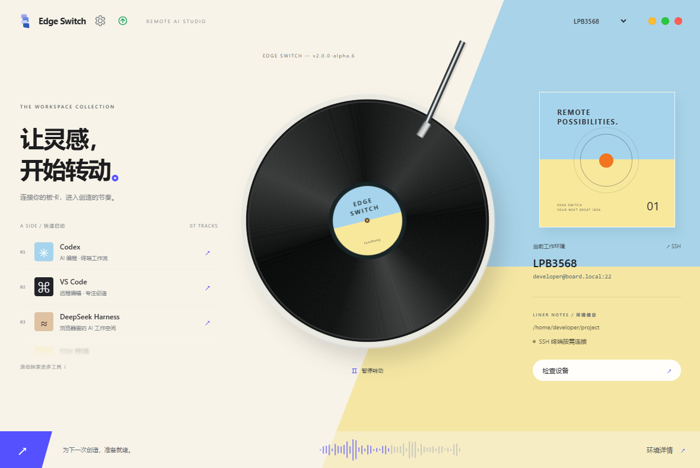
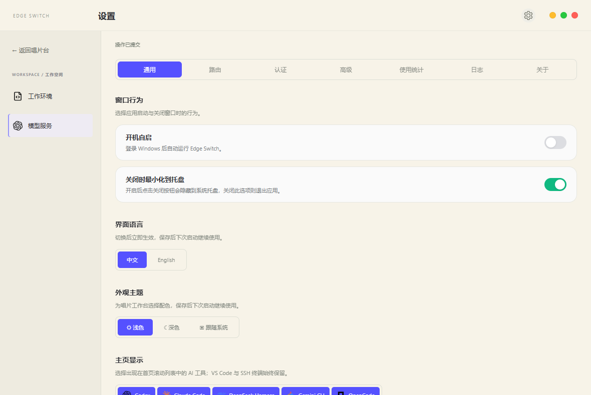
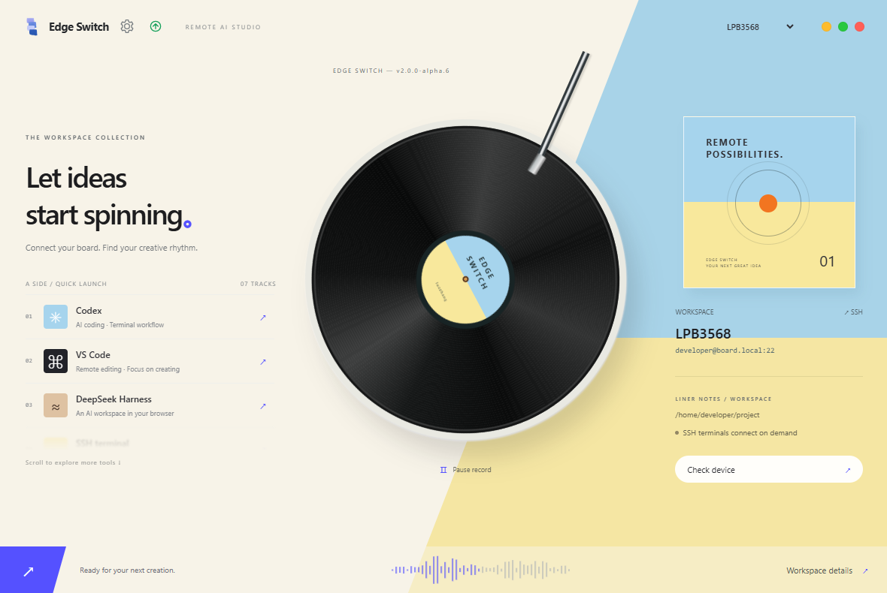
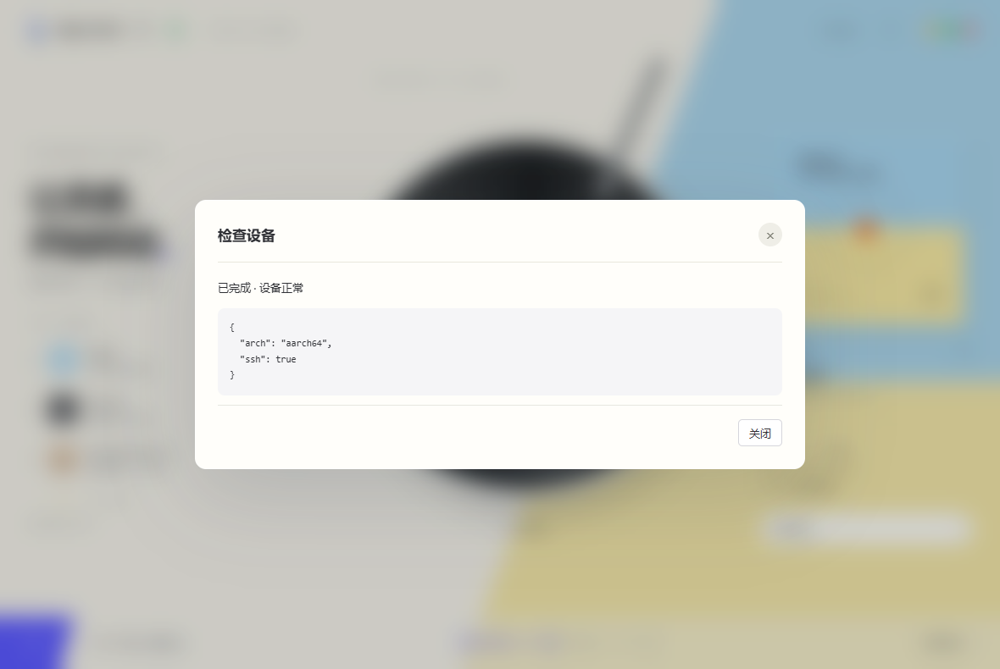

<div align="center">
  

# Edge Switch

通过 SSH，为 Linux 板卡配置 AI 开发工具、代理网络与模型 API。

[中文](README.md) · [English](README.en.md) · [下载 v2.0.0-alpha.6](https://github.com/luozhang1024/Edge-switch/releases/tag/v2.0.0-alpha.6)

[](https://github.com/luozhang1024/Edge-switch/releases)
[](LICENSE)

</div>

## 项目简介

Edge Switch 是运行在 Windows 上的远程开发工作台，使用 Tauri 2、Rust、React 和 TypeScript。AI CLI 工具安装并运行在 SSH 连接的 Linux 板卡上，应用负责安装、启动、代理转发、官方账号登录和模型 API 供应商切换。

当前为 **2.0.0-alpha.6 预发布版**。已完成本地自动化与界面验证，尚未完成本版本的真实板卡及所有 Windows 环境验收。旧版 Python 桌面的说明见[历史文档](docs/历史说明.md)，迁移细节见 [Tauri 文档](docs/tauri-migration.md)。

## 这一版有什么变化

- **工作环境**：内置本机 Windows 环境，新安装默认选中；升级自动补齐并保留已有环境选择。创建或编辑具体板卡时配置 SSH 和代理，工具安装使用侧边栏独立入口，支持环境拖动排序。
- **模型服务**：各 CLI 默认显示自己的官方入口；Harness 默认提供待配置的 DeepSeek API。供应商操作悬停显示，选中后显示“使用中”，支持拖动排序。
- **通用设置**：选择开机自启、关闭窗口时是否隐藏到托盘，以及中文 / English 界面；语言立即切换并持久保存。
- **授权中心**：从侧边栏直接管理当前工作环境的工具账号授权。
- **使用统计**：从侧边栏查询板卡当前受管环境的会话用量，按日期、CLI 工具、供应商和模型筛选，查看 Token 趋势、请求日志与模型汇总。
- **任务反馈**：检查设备、安装和同步等任务直接弹出进度、结果与错误；历史记录位于“设置 → 日志”。
- **快速启动排序**：首页工具支持拖动排序，自动保存；临时隐藏工具不丢失原有顺序。
- **工具安装**：侧边栏按当前环境管理工具，支持全部工具、AI 工具、运行环境、开发工具分类与搜索。已安装工具置顶，显示版本和来源，可一键安装、升级或卸载受支持的工具。AI 工具的“在模型服务中显示”开关按环境保存。本机使用 npm / winget；SSH 安装使用环境专属目录。
- **总成本与单价**：使用统计按筛选时间和环境汇总全部请求的成本，日志金额优先，缺少金额时用参考单价估算，显示计价覆盖和未计价数量。参考单价快照来自 `cc-switch-reference/src-tauri/src/database/schema.rs`，仅作估算；可在“设置单价”按环境、供应商、模型覆盖美元/百万 Token 单价，四类 Token 分别计费。供应商 `*` 为模型参考价，指定供应商优先；账号订阅通道不自动按 API 价格计费。修改单价会重新估算历史数据，不改变供应商账单。
- **账号与 API 切换**：Harness 账号通道提供启用和启动入口，可从多个 API 切回；Claude 等官方入口不再将未选择、未确认登录的状态显示为“使用中”。
- **会话中心**：侧边栏浏览当前环境的会话，支持搜索、工具筛选、对话阅读、复制、Markdown 导出与恢复命令复制。
- **会话阅读布局**：应用筛选显示各工具会话数；列表可按项目或日期分组并折叠。点击会话进入独立阅读页，支持前后切换、对话目录定位、消息复制与查找。执行过程默认折叠，可切换全部、对话和改动视图；日志中的模型与时间按实际记录显示。
- **提示词组**：侧边栏管理 Codex、Claude Code、Gemini CLI、DeepSeek Harness 和 OpenCode 的长期提示词，支持添加、搜索名称/说明/正文、编辑、复制正文、创建副本、启用、停用和删除。每个工具同时启用一条，界面显示实际目标文件与大小；新建条目默认停用，已启用条目保存后立即同步。首次打开自动导入已有文件，外部修改会回填到当前条目；切换前保存当前内容并在目标目录留下 `.edge-switch-*.bak` 备份。停用清空目标文件，库中正文保留，启用中的条目须先停用才能删除。本机使用原生配置目录；SSH 仅管理当前环境、当前账号/API 通道的专属目录，不写入其他环境或工程的 AGENTS.md。
- **便携版启动诊断**：附带微软 WebView2 引导安装程序和诊断启动脚本；应用启动失败时显示错误并记录日志。

开机自启作用于当前 Windows 用户登录，不需要管理员权限。便携版启用后请保持 EXE 所在目录不变；移动后重新关闭、开启一次自启以更新路径。关闭到托盘默认开启，关闭此选项后点击关闭按钮或 Alt+F4 会退出应用；任务进行中会提示先完成或取消。

使用统计按所选环境只读解析：本机 Windows 直接读取 Codex、Claude Code 和 DeepSeek Harness 的原生会话用量；SSH 环境读取当前受管目录中的五种工具日志。本机 Harness 的 zstd 压缩日志由程序直接解压，无需额外安装工具；远程压缩日志仍需要板卡上的 `zstd` 命令。仅包含日志中有用量的请求，供应商来源不明确时标为“会话日志”；费用优先使用日志记录的美元金额，缺少金额时按环境单价估算，缺少单价时显示 `—`，不按当前供应商倒推历史归属或账单。解析格式参考 `cc-switch-reference` 的会话用量实现，按各工具的缓存计数口径分别处理。

会话中心按所选环境读取：本机环境读取工具的本机目录（支持 `CODEX_HOME`、`CLAUDE_CONFIG_DIR`、`GEMINI_CLI_HOME`、`DSH_HOME` 与 `XDG_DATA_HOME`）；远程环境仅扫描当前受管目录。本机会话读取完整 JSON 记录，正确识别长元数据中的工程目录，并从 Codex 标题索引及只读状态数据库获取自定义标题；列表保留对话摘要，详情读取完整记录，单文件解压上限 128 MiB。Harness 自动选择同一会话的最新日志版本，支持连续压缩帧和正在写入的不完整末帧。列表与详情显示日志中的供应商、模型和 Token 用量；模型服务页自动展示本机 Codex 配置的供应商、模型和接口地址，不导入或展示原生密钥。远程列表仍最多展示 200 条、读取前 4 KiB，远程详情最多读取前 1 MiB，并提示截断。暂不读取 OpenCode SQLite 会话。恢复命令使用当前工具配置，在对应工程目录的终端运行；不删除原始会话文件。

## 界面预览

| 首页 | 通用设置 |
| --- | --- |
|  |  |
|  |  |

## 下载安装

从 [v2.0.0-alpha.6 Release](https://github.com/luozhang1024/Edge-switch/releases/tag/v2.0.0-alpha.6) 下载：

| 文件 | 用途 |
| --- | --- |
| `Edge Switch_2.0.0-alpha.6_x64-setup.exe` | 推荐。当前用户安装，自动检查、按需下载 WebView2，支持卸载 |
| `EdgeSwitch-2.0.0-alpha.6-Windows-x64.zip` | 完整解压到本地目录后运行 `Launch-EdgeSwitch.cmd`，检查 WebView2 后启动 |
| `EdgeSwitch.exe` | 单独的主程序，需要已安装 WebView2；首次使用推荐安装版或完整便携包 |
| `EdgeSwitch-2.0.0-alpha.6-source.zip` | 对应版本源码 |
| `SHA256SUMS.txt` | 发布附件的 SHA-256 校验值 |

要求 **Windows 10/11 x64** 和 **Microsoft Edge WebView2 Runtime**。当前不提供 Windows 7/8、32 位或 ARM 原生构建。WebView2 引导安装程序需要联网下载运行时；离线电脑请先安装微软官方对应架构的 WebView2 离线运行时。

升级前从系统托盘退出旧实例。安装包和 ZIP 不包含开发者的板卡配置、密钥或登录凭据；同事需要在自己的电脑上完成 SSH 授权，在对应板卡工作环境中完成模型账号认证。

### 双击没反应或一闪而过

1. 把 **整个 ZIP 解压**，不要直接在压缩软件的临时目录里运行。
2. 双击解压目录中的 `Launch-EdgeSwitch.cmd`。它会显示系统信息、检查 WebView2，缺少时打开微软引导安装程序；失败时保留窗口。
3. 查看 `%LOCALAPPDATA%\EdgeSSHAI\portable-launch.log` 和 `startup.log`，提交错误信息。日志不存在时，请记录 Windows 的安全拦截或系统错误提示。
4. 已有程序可能隐藏在系统托盘中。先从托盘退出旧实例，再启动新版。

Microsoft Defender SmartScreen 可能因程序尚无代码签名而显示提示。请核对下载来源、SHA-256 和提示内容；无需关闭安全软件。仅凭“双击无反应”无法判断是运行时缺失、系统不兼容还是安全拦截。

## 快速开始

本机 Windows 环境无需 SSH，可编辑工程目录、检查本机工具，并打开 PowerShell、VS Code 和已加入 PATH 的 CLI。工具沿用本机已有配置；目前本机安装、模型配置和账号登录需在本机终端完成，应用内受管安装、模型同步及用量查询仍适用于远程板卡。内置本机环境不可删除。

1. 点击首页唱片进入 **工作环境**，创建板卡环境；在 **SSH 与网络** 中填写主机、Linux 用户、端口、工程目录和私钥。
2. 选中该环境，在侧边栏 **工具安装** 中按分类选择并一键安装所需工具。本机先安装 Node.js，再安装 AI CLI；Node.js、Git 与 VS Code 通过 winget 管理。SSH 首次安装 AI 工具自动准备独立 Node.js，不替换系统 Node.js。非 npm 安装的本机 AI 工具需使用原安装方式升级或卸载；远程系统工具仅检测，受管 Node.js 保留，避免影响其他工具。
3. 按需配置电脑代理端口和工具线路。板卡使用电脑代理时通过 SSH 反向转发；修改配置前先断开已有隧道。
4. 点击首页矩形封面进入 **模型服务**。CLI 工具和 API 供应商是两个概念：先选工具，再选择其官方账号或添加自己的 API。统一 New API 供应商可供多个工具复用。
5. Codex 的 OpenAI Official 在 **设置 → 认证** 中登录或导入 `auth.json`；Claude、Gemini、OpenCode 的官方卡片提供终端登录入口。Harness 配置模型名称与 API Key。
6. 悬停供应商，点击第一个图标启用；自定义 API 通过 **验证与同步** 写入板卡。回到首页启动 Codex、VS Code、Harness 或 SSH 终端。

工具安装、官方登录能力和订阅要求取决于上游 CLI。打开登录终端不等于授权成功。Codex 自定义 API 需要兼容的 Responses 接口；应用自动选择工具需要的格式，服务端仍须支持对应接口。推理验证可能消耗余额，执行前会确认。

板卡需支持 SSH、Python 3、可写用户目录及上游工具要求的 Linux 运行库。既往实机验证平台为 **LPB3568 / ARM64 / glibc 2.31**；这不代表所有板卡、工具版本和供应商均已验收。

## 配置与数据

- 本地目录：`%LOCALAPPDATA%\EdgeSSHAI`，保留旧版名称用于兼容。
- API Key 可用当前 Windows 用户的 DPAPI 加密保存；不勾选保存时只在当前进程内保留。
- 官方登录和自定义 API 使用工具、工作环境各自的远程配置目录，避免串用凭据；不会替换共享 `~/.codex` 或修改 `.bashrc`。
- “SSH 终端按需连接”不表示 SSH 失败：首页只统计应用维护的代理和网页隧道，外部终端独立连接。用 **检查设备** 验证设备状态。
- 不要把本地配置、SSH 私钥、API Key 或 `auth.json` 发给同事。共享 Linux 账号时，其他同账号进程仍可能读到凭据；强隔离请使用不同 Linux 用户。

更多供应商与认证说明见[模型服务文档](docs/model-services.md)。

## 开发与构建

Windows 构建需要 Node.js 24、Rust stable、MSVC Build Tools 和 WebView2。

```powershell
npm ci
npm test
npm run test:ui
npm run build
cargo test --manifest-path src-tauri/Cargo.toml --locked --lib
npm run desktop:build
```

输出在 `dist/tauri/`，不会提交到 Git。`npm run test:desktop` 需要先退出已有实例；它通过 WebView2 检查桌面安装包中的实际页面。`npm run test:ui` 使用模拟板卡数据验证浏览器交互，不代表真实板卡验收。

推送 `v2.*` 标签会触发 Windows 构建和检查，全部通过后自动发布预发布版、附件及校验文件。旧版 Python 代码和回归测试保留用于迁移验证；其构建入口不用于 2.x Release。

Python 回归测试统一位于 [`tests/`](tests/README.md)，在项目根目录运行 `python -m pytest -q`；需要安装 `requirements.txt`、`pytest`，并具备可用的 Windows Tcl/Tk 环境。

## 反馈

请在 [Issues](https://github.com/luozhang1024/Edge-switch/issues) 附上软件版本、Windows 版本、CPU 架构、具体提示和脱敏日志。程序无法启动时优先附上启动日志；不要上传密钥和账号令牌。

## 致谢

- [OpenAI Codex](https://github.com/openai/codex)：AI 编程助手与远程开发工具。
- [DeepSeek Harness](https://github.com/deepseek-ai/deepseek-harness)：终端与 Web AI 开发工作流。
- [CC Switch](https://github.com/farion1231/cc-switch)：供应商卡片交互与官方账号配置方式的参考。
- [CustomTkinter](https://github.com/TomSchimansky/CustomTkinter)、[PyInstaller](https://github.com/pyinstaller/pyinstaller)、[Inno Setup](https://jrsoftware.org/isinfo.php)：桌面界面与 Windows 打包工具。

## 开源协议

Copyright © 2026 luozhang。Edge Switch 的项目原创代码采用 **GNU Affero General Public License v3.0（AGPL-3.0-only）**，完整条款见 [LICENSE](LICENSE)。

- 允许使用、研究、修改和商业使用；AGPL 不禁止商用。
- 分发受本协议覆盖的软件或修改版时，应保留版权、许可及相关声明，并按协议提供对应源码；分发修改版时应按 AGPL-3.0 授权并标明修改。
- 如果修改本程序并通过网络向用户提供交互服务，应按协议第 13 条，向这些用户显著提供免费获取该修改版对应源码的途径。
- 软件按“现状”提供，不附带任何担保，具体免责及责任限制见协议全文。

第三方依赖、上游 AI 工具及其他权利人的素材仍遵循各自的许可和使用条款，本协议不改变其授权。以上为使用说明，具体权利和义务以 LICENSE 全文为准。

## 贡献与商业授权

欢迎提交代码、文档、测试和问题反馈，请参阅 [贡献指南](CONTRIBUTING.md)。社区贡献按 AGPL-3.0-only 提供，贡献者保留著作权；**无需签署 CLA，也无需额外的签署评论或 DCO Signed-off-by**。

项目另有闭源收费的企业版。社区贡献不会因提交或合并 PR 而自动获得闭源商业再许可；如需将某项外部贡献纳入闭源企业版，维护者会另行征求相关权利人的明确书面授权，贡献者可以拒绝。

需要企业版或其他商业授权时，可通过本仓库联系维护者 `luozhang1024`。社区版允许按 AGPL 商业使用，无须仅因商用而购买企业版。

## Star History

[](https://www.star-history.com/#luozhang1024/Edge-switch&Date)

## 支持项目

如果 Edge Switch 帮你节省了部署和排查时间，欢迎点亮 Star、提交建议，或自愿赞助项目维护。

<div align="center">
<table>
  <tr>
    <th align="center">微信支付</th>
    <th align="center">支付宝</th>
  </tr>
  <tr>
    <td align="center"></td>
    <td align="center"></td>
  </tr>
</table>

Maintained by **luozhang**
</div>
